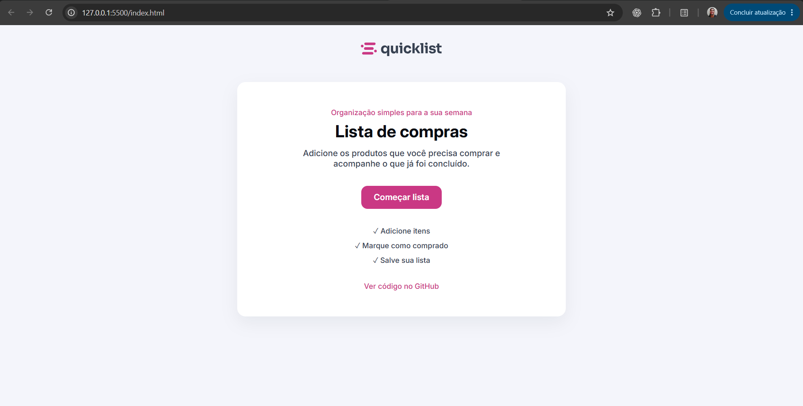
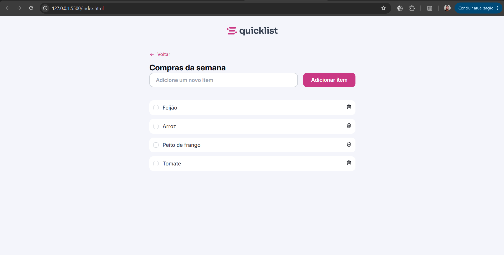

# 🛒 Lista de Compras

Uma aplicação web simples para organizar as compras da semana. O projeto foi criado para praticar HTML, CSS, JavaScript puro e manipulação do DOM em um fluxo de uso real.

[Demo](https://jpfreitas-dev.github.io/shopping-list/) · [Código no GitHub](https://github.com/jpfreitas-dev/shopping-list)

## Sobre o projeto

A aplicação começa em uma tela inicial simples e leva o usuário para a lista de compras por meio do botão “Começar lista”. Dentro da lista, é possível criar itens, marcar produtos como comprados e remover itens concluídos ou desnecessários. É um projeto de estudo com foco em eventos, renderização dinâmica e experiência responsiva.

## Funcionalidades

- Adicionar itens pelo botão ou pela tecla Enter.
- Navegar entre a tela inicial e a lista de compras.
- Impedir o cadastro de itens vazios.
- Marcar e desmarcar itens como comprados.
- Remover itens com feedback visual.
- Persistir a lista no `localStorage` do navegador.
- Usar a interface em dispositivos móveis e desktops.

## Demonstração

O projeto está preparado para publicação como um site estático no GitHub Pages.

### Tela inicial



### Lista de compras



## Tecnologias utilizadas

- HTML5 para a estrutura semântica.
- CSS3 para estilos responsivos, variáveis e estados visuais.
- JavaScript para eventos, manipulação do DOM e persistência local.
- Google Fonts para a tipografia Inter.

## Testes manuais

- Adicionar um item pelo botão.
- Adicionar um item pressionando Enter.
- Tentar adicionar um campo vazio.
- Marcar e desmarcar um item.
- Recarregar a página e confirmar que os itens continuam salvos.
- Remover um item e fechar o alerta.
- Repetir o fluxo em uma viewport mobile e em uma viewport desktop.

## Estrutura do projeto

```text
shopping-list/
├── index.html          # Estrutura principal da aplicação
├── script.js           # Estado, eventos e renderização da lista
├── styles/
│   ├── global.css      # Reset, variáveis e tipografia
│   └── style.css       # Layout e estilos específicos
└── assets/             # Logo, ícones e estados visuais
```
